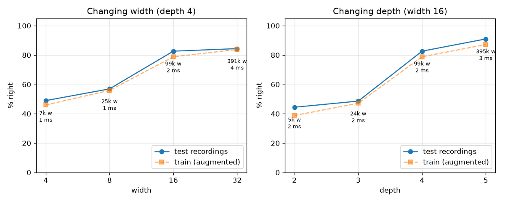
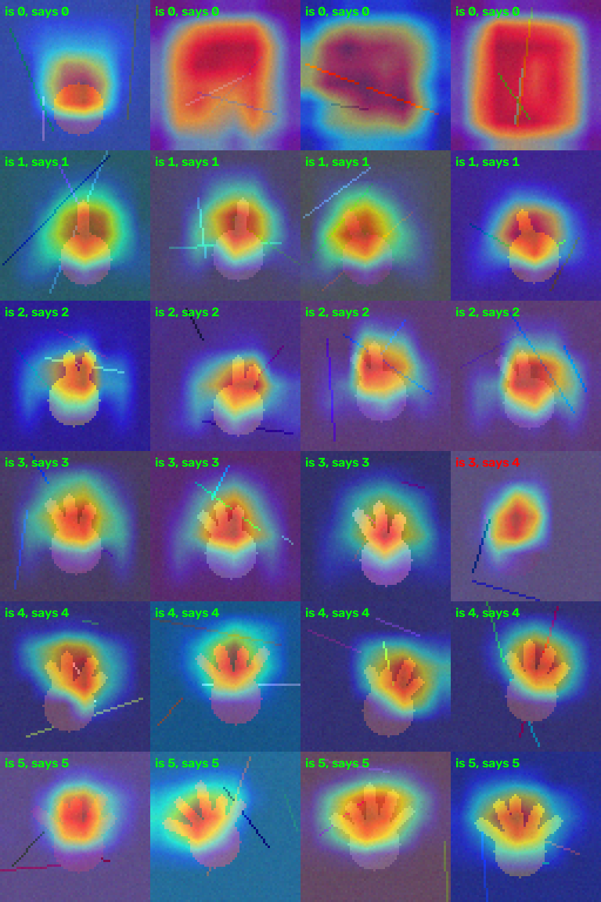

# How the finger counter works

The lock needs one thing from a neural net: given a camera picture, **how
many fingers are up (0-5)?** This explains the network that does it,
[FingerNet](model.py), and why each piece is there, using its real numbers.
Every claim here can be checked by running something: `python model.py`,
`python backprop_demo.py`, `python sweep.py`, `python gradcam.py`.

> The example numbers below (accuracies, sweep) come from **synthetic hands**
> I used to test the pipeline before collecting real pictures. Re-run
> `train.py`, `sweep.py` and `gradcam.py` on the real data and the same
> results files update.

## 1. The input

The webcam gives a 640x480 colour frame. [vision.py](unoq_app/python/vision.py)
takes the centre 480x480 square and shrinks it to **64x64**, so the input is
3 x 64 x 64 = 12,288 numbers. Each colour channel is then standardized (mean 0,
std 1) on its own. That removes overall brightness and colour cast, so the net
has to use shapes, not lighting. The same file does this on the laptop and on
the board, so the net never sees different preprocessing in the two places.

## 2. Neurons, layers, width and depth

A neuron computes a weighted sum of its inputs plus a bias and passes it
through a non-linearity. Here that is **ReLU**, max(0, z). Without the
non-linearity, any stack of layers would collapse into a single linear
function, and no amount of depth would help.

- **Width** = how many neurons (for a conv layer: how many **channels**, i.e.
  feature detectors) a layer has. FingerNet's width W is the first layer's
  channel count, and each block doubles it: 16 → 32 → 64 → 128.
- **Depth** = how many layers with weights are stacked. FingerNet has 4 conv
  layers + 1 linear layer.

`python model.py` prints the default net (W=16, depth 4):

```
layer                                    output   weights  sees (px)
conv1 3x3 3->16 BN ReLU                16x64x64       480       3x3
maxpool 2x2                            16x32x32         0       4x4
conv2 3x3 16->32 BN ReLU               32x32x32     4,704       8x8
maxpool 2x2                            32x16x16         0      10x10
conv3 3x3 32->64 BN ReLU               64x16x16    18,624      18x18
maxpool 2x2                              64x8x8         0      22x22
conv4 3x3 64->128 BN ReLU               128x8x8    74,112      38x38
global average pool                         128         0      64x64
linear 128->6                                 6       774      64x64
total                                              98,694
```

A conv layer's weight count is in_channels x out_channels x 3 x 3 (+ biases),
so **weights grow with width squared but only linearly with depth**: conv4
alone (64 x 128 x 9 = 73,728) holds 75% of the net.

[sweep.py](sweep.py) trains the same data at different widths and depths
(synthetic hands, 12 epochs each):

| width | depth | weights | test accuracy |
|---:|---:|---:|---:|
| 4 | 4 | 6.5k | 49% |
| 8 | 4 | 25k | 57% |
| **16** | **4** | **99k** | **83%** |
| 32 | 4 | 391k | 84% |
| 16 | 2 | 5.4k | 44% |
| 16 | 3 | 24k | 49% |
| 16 | 5 | 395k | 91% |



What the sweep shows:
- **Width** helps until each layer has enough feature detectors (16), then
  levels off: 4x the weights for W=32 bought 2%.
- **Depth** matters more here, and the "sees" column explains why. One output
  of conv2 sees only an 8x8 patch of the picture, too small to contain a whole
  hand, so a depth-2 net can find finger edges but can't count them. By conv4
  each value sees 38x38, a whole hand. Depth gives the net a **hierarchy**:
  edges → finger segments → fingers → "three fingers next to each other".
- Depth 5 is better still on synthetic data, but it has 4x the weights. I kept
  depth 4: 99k weights is ~2 ms per picture in numpy on the laptop, which
  leaves room on the UNO Q's much slower cores.

## 3. Forward pass and loss

The forward pass runs the layers in order and produces 6 **scores** (logits),
one per count. **Softmax** turns them into probabilities:
p_k = e^{z_k} / Σ e^{z_j}. The loss is **cross-entropy**, -log(p of the right
count). It is 0 when the net is certain and right, and very large when it is
confidently wrong. The loss is averaged over a batch of 64 pictures. Counts
with fewer pictures get a larger weight in it, so a pile of "0" pictures can't
teach the net to just answer 0.

## 4. Backpropagation

Training needs **∂loss/∂w for every one of the 98,694 weights**.
Backpropagation gets them all in one backward pass using the chain rule. Each
layer receives the gradient of the loss with respect to its *output* and
works out:
1. the gradient for its own **weights** = (gradient arriving) x (the input
   it multiplied), and
2. the gradient to pass **back** to its input = (gradient arriving) through
   its weights, transposed.

[backprop_demo.py](backprop_demo.py) does this by hand for a 2-layer net and
checks it against PyTorch's `loss.backward()` (they agree to 1e-7):

```
dz2 = (p - onehot) / n          softmax + cross-entropy: gradient at the scores
dW2 = dz2ᵀ h,   db2 = Σ dz2      the last layer's weights
dh  = dz2 W2                     passed back to the hidden layer
dz1 = dh * (z1 > 0)              ReLU: lets the gradient through only where it was on
dW1 = dz1ᵀ x,   db1 = Σ dz1
```

It also does the two layers a CNN adds:
- **Convolution:** the same 9 kernel weights are used at every position, so
  each weight's gradient is the **sum over all positions** of (gradient there)
  x (the pixel under it). That weight sharing is why a conv layer has so
  few weights.
- **Max pool:** only the biggest value in each 2x2 block affected the output,
  so it gets the whole gradient and the other three get 0. Max pool *routes*
  gradients; it has no weights to learn.

## 5. Gradient descent

The gradient points in the direction in which the loss increases fastest, so
each weight takes a small step the opposite way. [train.py](train.py) writes
the update out by hand (`SGDMomentum`) instead of calling `torch.optim`:

```
g = ∂loss/∂w + weight_decay · w      weight decay: a pull towards small weights (less overfitting)
v = momentum · v + g                 momentum 0.9: a running sum of recent gradients
w = w − lr · v
```

- **Stochastic:** each step uses the gradient of one random batch of 64
  pictures, not the whole dataset. That's noisier, but each step is cheap.
- **Momentum:** steps in directions where the gradients agree build up, and
  zig-zags across a narrow valley cancel out.
- **Learning rate:** 0.05 after a one-epoch warm-up, then a cosine curve down
  to 0, so the steps are big early and fine at the end.
- Part 3 of `backprop_demo.py` runs plain gradient descent with the hand-made
  gradients: loss 1.35 → 0.26.

## 6. Convolution: why a CNN for pictures

A fully connected first layer on 12,288 inputs with 16 neurons would need
~197k weights, and it would have to learn "a finger" separately at every
position. A **3x3 convolution** slides one small kernel over the whole image:
- **Weight sharing:** conv1 has 16 kernels x 27 weights = 432 weights (plus
  biases), however big the picture is.
- **Translation equivariance:** a finger detector works wherever the finger
  is.
- **Locality:** pixels near each other are related, so each kernel looks at a
  3x3 neighbourhood. Larger shapes are built by stacking layers (section 2).

Padding 1 keeps the size (64 → 64). Each output channel is one learned
feature map. In [fingernet.py](unoq_app/python/fingernet.py) the board does
the same operation with `sliding_window_view` + `tensordot` and no loops.

## 7. Pooling

- **2x2 max pool** after conv1-3 halves the height and width (64 → 32 → 16 →
  8). It keeps only the strongest response in each block, which means:
  - 4x less work for the next layer,
  - the receptive field grows faster (see the "sees" column),
  - a feature moving by a pixel doesn't change the output: a little
    **invariance** to exactly where the finger is.
- **Global average pooling** at the end averages each of the 128 8x8 maps to
  one number. The linear layer then only needs 128 x 6 weights instead of
  8192 x 6, and it doesn't care *where* in the picture the hand is, only what
  was found.

## 8. Generalization: what made it work

The interesting failure: on synthetic hands with **5 recordings per count**
(40 near-identical frames each), the net reached 99% on training data but
**~40%** on held-out recordings. It had memorized each recording's background.
With the same number of pictures spread over **30 recordings per count**, it
got **97%**. So:
- [train.py](train.py) tests on **whole held-out recordings**. A random split
  would put almost-identical frames on both sides and report a fake ~99%.
- [collect.py](collect.py) records short 3 s bursts so you make many
  different ones.
- **Data augmentation:** every batch is randomly rotated (±25°), zoomed,
  shifted, mirrored (= the other hand), and has its brightness, contrast and
  colour changed, all on the batch at once with an affine grid.
- **Dropout** (30%) before the last layer, plus weight decay.
- **Batch normalization** after each conv. In training, each channel is
  normalized over the batch and then rescaled by a learned γ, β. Here it
  reached 99% training accuracy about 3x faster.

## 9. Something new: Grad-CAM, seeing what the net looks at

A 97% score doesn't tell you *why* the net is right. It could be counting
fingers, or it could have learned that "3" pictures happened to have a sleeve
in them. **Grad-CAM** (Selvaraju et al., 2017) answers that with
backpropagation, but asks a different question. Instead of "how should each
weight change?", it asks **"how much does each spot of the last feature maps
raise the score for the answer?"**

```
A_c       = conv4's 128 feature maps (8x8 each)
α_c       = mean over the map of ∂score/∂A_c      how much channel c matters for this answer
heat map  = ReLU( Σ_c α_c · A_c )                 upsampled to 64x64
```

[gradcam.py](gradcam.py) makes a grid of test pictures (`--wrong` shows only
the mistakes), and `laptop_lock.py` shows it **live** (key `g`). On the
synthetic hands the heat sits on the **fingers**, not the palm or the clutter
lines. For "0" it spreads over the whole picture ("no finger anywhere"). The
one mistake in the grid was a hand almost the same colour as its background:



That's the test to run on real data: if the heat is on the table edge or your
sleeve, the net is cheating, and the fix is more varied pictures, not more
epochs.

### Other things in here we haven't done in class

- **BatchNorm folding** ([model.py](model.py) `fold_batchnorm`). After
  training, BN is a fixed per-channel scale s = γ/√(var+ε) and shift, so it can
  be merged into the conv: w' = s·w, b' = s·(b − mean) + β. The board runs
  plain convs and never knows BN was there. [train.py](train.py) checks that
  the exported numpy net matches PyTorch (to ~3e-5) before saving it.
- **Not trusting an unsure net.** The lock smooths the probabilities over
  frames and only accepts a count with ≥80% probability held for 0.8 s. On
  the synthetic test set, 72% of pictures reached 80% confidence, and **100%
  of those were right**.
- **Security:** the code is stored as a salted SHA-256 hash and compared in
  constant time; wrong codes trigger a doubling lockout; and the sketch is
  **fail-secure**: if Python goes quiet for 5 s, the servo relocks.
